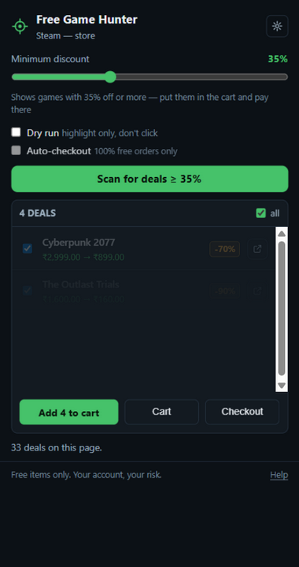
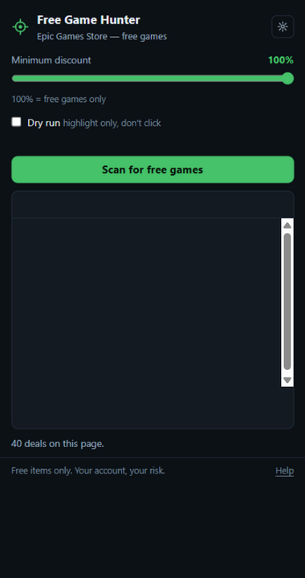
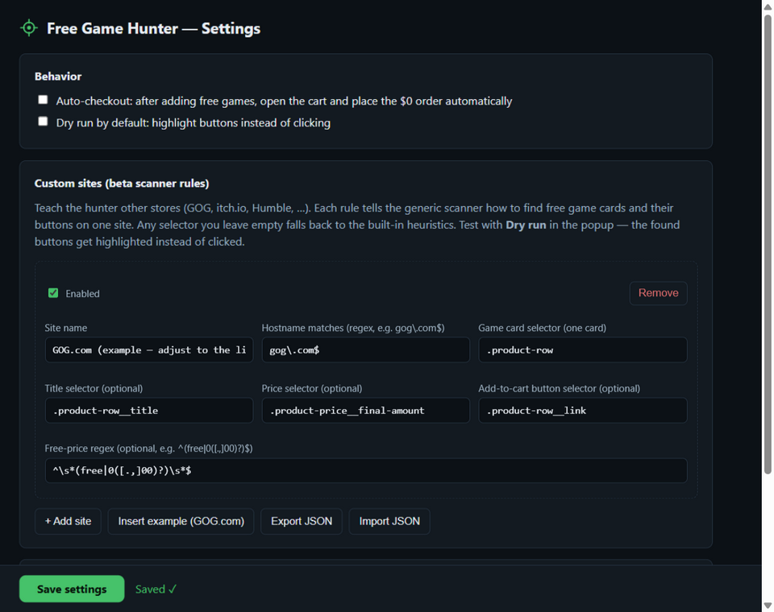
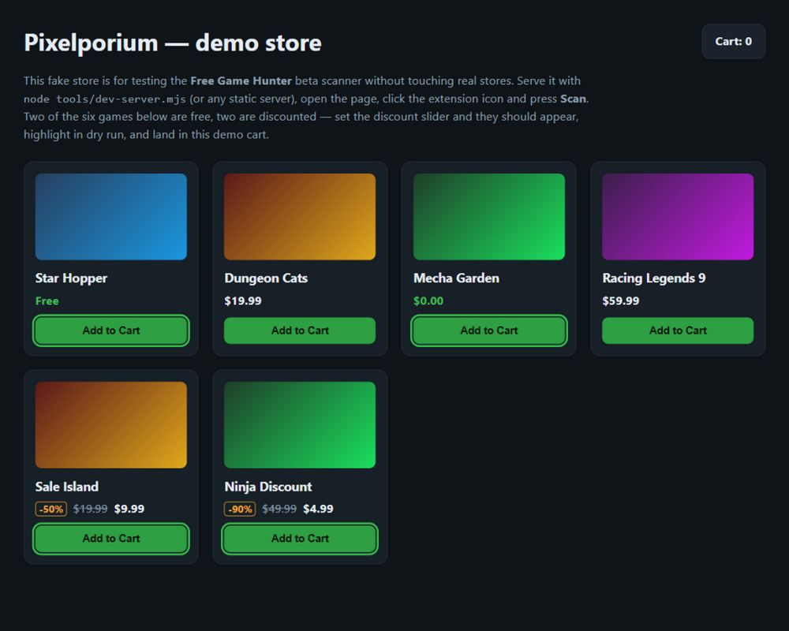

<div align="center">

# Free Game Hunter — Steam & Epic

**A Chrome extension that finds every free and discounted game on Steam and the Epic Games Store,
adds them to your cart in one click, and can place the $0 order for you.**


[Overview](#overview) · [Screenshots](#screenshots) · [Installation](#installation) · [Usage](#usage) · [How it works](#how-it-works) · [Other stores](#other-stores) · [FAQ](#faq)

</div>

---

## Overview

Free Game Hunter scans the store page you are on, lists every free or discounted game it finds with
the old → new price, and lets you:

- **Add them all to your cart in one click** — including games whose buttons live deeper in the
  store (it opens each game page in a background tab, clicks *Add to Cart* / *Get*, and closes the tab)
- **Open any game's store page directly** from the results list to buy it individually
- **Auto-checkout 100% free orders** — it opens the cart, clicks *Purchase* / *Place Order*, and the
  games land in your library (locked to $0 orders only, with a cart audit before every purchase)
- **Dial in any discount** with a 0–100% slider: 100% = free games only, 55% = everything at 55% off
  or more, 0% = every deal on the page
- **Test other stores safely** with a dry-run mode that highlights buttons instead of clicking, a
  bundled fake demo store, and custom selector rules for sites like GOG or Humble

Everything runs locally in your browser. No account data is read, nothing is sent anywhere.

## Screenshots

<div align="center">
<table>
  <tr>
    <td align="center"><br/><sub>Discount deals with badges, old → new prices, per-row open buttons</sub></td>
    <td align="center"><br/><sub>Free-only mode — Epic giveaways pre-checked to claim</sub></td>
  </tr>
  <tr>
    <td align="center"><br/><sub>Settings and custom store rules (example: GOG.com)</sub></td>
    <td align="center"><br/><sub>Dry run on the bundled demo store — highlights, no clicks</sub></td>
  </tr>
</table>
</div>

## Features

| | Feature | Detail |
|---|---|---|
| 🎯 | **One-click scan** | The toolbar badge shows how many free items the current page has, before you even open the popup |
| 🛒 | **Batch add to cart** | Pre-checked free games, one click adds them all — background tabs handle games without inline buttons |
| 📉 | **Discount slider 0–100%** | Any threshold: 20%, 50%, 90%… shows `-50%`-style badges and old → sale prices |
| 🔗 | **Per-row open button** | Jump straight to any game's store page to buy it individually |
| 🤖 | **Auto-checkout for free games** | Cart → *Purchase* / *Place Order* — and only for carts that audit as $0 |
| 💡 | **Dry run** | Highlight what *would* be clicked, on any site, before allowing a single click |
| 🧩 | **Other stores** | Beta scanner works on any site; custom selector rules for GOG, Humble, itch.io, … |
| 🧪 | **Demo store included** | A fake store with free, discounted and paid games for safe testing |
| 🔔 | **Notifications & history** | Background claims notify you; the popup keeps a recent-activity log |

## Installation

1. Download this repository (or `git clone` it)
2. Open `chrome://extensions` in Chrome or Edge
3. Turn on **Developer mode** (top-right toggle)
4. Click **Load unpacked** and select the folder containing `manifest.json`
5. Pin the 🎯 icon and log in to Steam / Epic as usual

Or grab the packaged zip from [Releases](https://github.com/trytotest13/Steam-and-Epic-Games-Free-Game-Hunter/releases) — every `v*` tag is packaged automatically by CI.

## Usage

1. Open a store page — e.g. Steam's [specials search](https://store.steampowered.com/search/?specials=1),
   Epic's [free games](https://store.epicgames.com/en-US/free-games), or any game page
2. Click the extension icon → **Scan** (the popup auto-detects Steam / Epic / other sites)
3. Check the games you want (free ones are pre-checked) → **Add to cart**
4. Use the per-row **open button** (arrow-in-box) to buy a specific game individually
5. Optional: enable **Auto-checkout** — after adding, the cart opens and the $0 order is placed

### Discount slider

| Position | Behaviour |
|---|---|
| **100%** (default) | Free games only — auto-checkout eligible |
| **20 / 50 / 90** | Everything with at least that discount, with badges and old → sale prices |
| **0%** | Every discounted game on the page |

Auto-checkout is intentionally disabled below 100% — discounted games go to your cart and you pay
there yourself.

### Safety rails

- **Dry run** highlights the buttons it *would* click — nothing is clicked
- **$0 audit**: before any auto-checkout the cart page is scanned for paid prices; any paid item
  (or an unreadable total) skips the automatic purchase
- **Free-to-play games** are listed but never pre-checked — they have nothing to claim in the browser

## How it works

| Page | What the extension does |
| --- | --- |
| Steam search / listing rows | Rows have no inline cart button → opens each game page in a background tab, clicks *Add to Cart*, closes the tab |
| Steam game page (100% off box) | Clicks *Add to Cart* directly |
| Steam cart | Verifies the total is $0, then clicks *Purchase* |
| Epic free-games listing / homepage cards | Finds "Free Now" / "Free" tiles → opens each game page in a background tab, clicks *Get*, closes the tab |
| Epic game page | Clicks *Get* directly |
| Epic cart → checkout | Clicks *Check Out*, accepts the EULA checkbox if shown, clicks *Place Order* |
| Any other site | Beta scanner: finds free prices next to cart buttons, or uses your custom rule |

The scanners are text-first ("Free", "$0.00", "-50%", "Get", "Purchase") so they survive store
redesigns, with class-based fast paths where stores are stable.

## Other stores

- **Beta scanner**: open any store, click the icon, press **Scan** — free prices next to cart-style
  buttons are detected anywhere
- **Custom rules**: ⚙ → *Custom sites* → add the hostname regex and CSS selectors for the game card,
  title, price and button (an example for GOG.com is included; adjust it with DevTools). Rules can
  be exported/imported as JSON
- **Demo store**: run `node tools/dev-server.mjs` and open <http://127.0.0.1:8123> to test safely —
  two free games, two discounted, two paid

## CI

GitHub Actions runs on every push and pull request (`scripts/validate.mjs`, zero dependencies):
manifest sanity, every referenced file exists, PNG icon signatures, `node --check` on every script —
then packages `FreeGameHunter-<version>.zip` as an artifact. Tags starting with `v` get a GitHub
release with the zip. Run the same gate locally with `npm run validate`.

## Project structure

```
manifest.json               MV3 manifest (permissions, content scripts)
background/service-worker.js  badge, notifications, per-tab claim jobs
content/common.js           scanning engine + $0 cart audit + command router
content/steam.js            Steam adapter
content/epic.js             Epic adapter (text-based, survives their React redesigns)
content/generic.js          beta scanner for other sites (injected on demand)
popup/                      the one-click popup UI
options/                    settings + custom site rules editor
demo/test-store.html        offline fake store for safe testing
scripts/validate.mjs        CI quality gate
tools/                      icon generator, demo dev server, CDP self-tests
docs/screenshots/           the screenshots above
DESIGN.md                   the UI design contract
```

## FAQ

**Is it safe?** It only clicks buttons on pages you already use, only ever tries to complete **$0**
orders, and refuses auto-checkout when the cart contains anything paid. Use dry run on new sites.

**Does it work without logging in?** Scanning works logged out; claiming and checkout need you
logged in to the store, in the same browser. Epic may occasionally show its own captcha — complete
it once and continue.

**A store updated and scan finds nothing?** Reload the page first (content scripts only inject into
pages loaded after the extension). If it still fails, the popup now shows the actual error — open an
issue with that message.

**Free-to-play games?** Listed but not pre-checked — there is nothing to claim in the browser;
install them from the store client.

## Privacy

Everything runs locally. Settings live in `chrome.storage.sync`, history in `chrome.storage.local`.
No analytics, no network calls, no account access.

## Disclaimer

Automating clicks is your own account and your own risk — review each store's terms of service.
Keep **dry run** on when trying a new site, and check the cart before any purchase.

## License

[MIT](LICENSE) © trytotest13
